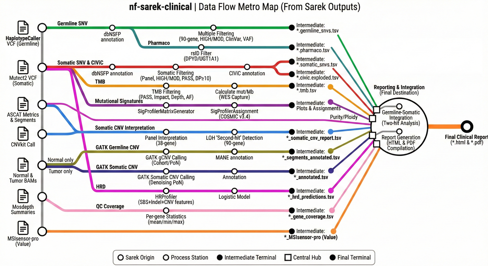

# nf-sarek-clinical

**Clinical interpretation postprocessing pipeline for nf-core/sarek WES cancer exome outputs.**

[](https://www.nextflow.io/)
[](https://www.docker.com/)



---

## What this pipeline does

`nf-sarek-clinical` takes the output of [nf-core/sarek](https://nf-co.re/sarek) (tumour–normal WES) and produces a clinical-grade molecular report in HTML and PDF format. It integrates germline and somatic variant analysis, copy-number calling, mutational signatures, CIViC clinical evidence, pharmacogenomics, and HRD scoring into a single automated workflow. It can also run in full mode from FASTQ to report.

**Key features:**

- **Somatic consensus calling:** Mutect2 + Strelka2 intersection — only variants confirmed by both callers feed into TMB, mutational signatures, and HRD. Falls back to Mutect2-only when Strelka2 is not available
- ACMG 2015 germline classification with ClinGen SVI points (Tavtigian 2020): PVS1 by gene mechanism and variant type, PM2_Supporting, REVEL with calibrated cut-offs (Pejaver 2022)
- CIViC Level A/B actionable somatic variant annotation
- Germline–somatic correlation: two-hit analysis for MMR/HRR pathways
- Mutational signatures (SBS/DBS/ID) with COSMIC v3.4 aetiology mapping
- Low-coverage QC warnings (biomarkers flagged as indeterminate when tumour depth < 50X)
- Bilingual reports (English / Spanish)
- All filtering thresholds centralised in `conf/filters.config`

**Final deliverables per patient:**

- `*_molecular_report.html` — interactive report with all findings
- `*_clinical_report.pdf` — printable PDF with KPI dashboard and Major Clinical Findings summary
- Structured TSV files for each analysis module (variant tables, CNV tables, TMB, HRD)

---

## Quick Start

> For a detailed walkthrough of each step, see [First-time setup](#first-time-setup) and [Running the pipeline](#running-the-pipeline) below.

**1. Install Nextflow and Docker**

```bash
# Nextflow
curl -s https://get.nextflow.io | bash
sudo mv nextflow /usr/local/bin/

# Docker — https://docs.docker.com/get-docker/
# Java 11+ is also required (e.g. sudo apt install default-jre)
```

**2. Configure access to the private GitHub repository**

Create `~/.nextflow/scm` with your GitHub credentials:

```groovy
providers {
    github {
        user     = 'YOUR_GITHUB_USERNAME'
        password = 'YOUR_GITHUB_TOKEN'   // token with repo read scope
    }
}
```

**3. Download reference files**

See [Reference files](#reference-files) for full download instructions. Required files:

- dbNSFP 4.1a (`dbNSFP4.1a.txt.gz` + `.tbi`)
- SnpSift JAR (`SnpSift.jar` from snpEff bundle)
- hg38 FASTA + dict
- GATK CNV Panel of Normals and interval lists (from [FlorPio/gatk-cnv-somatic](https://github.com/FlorPio/gatk-cnv-somatic))
- MANE transcript list (`exons_mane.txt`)
- WES capture BED file for your kit

**4. Create your `lab_params.yml`**

```bash
cp /path/to/nf-sarek-clinical/full_pipeline.params.yml lab_params.yml
# Edit lab_params.yml — replace all /path/to/ entries with your real paths
```

**5. Prepare a samplesheet**

Create a CSV for nf-core/sarek (required only for Mode A — full FASTQ to report):

```csv
patient,sex,status,sample,lane,fastq_1,fastq_2
P001,XX,0,P001_N,L001,/data/P001_N_R1.fastq.gz,/data/P001_N_R2.fastq.gz
P001,XX,1,P001_T,L001,/data/P001_T_R1.fastq.gz,/data/P001_T_R2.fastq.gz
```

**6. Run the pipeline**

*Mode A — full run (FASTQ → report):*

```bash
cd /path/to/nf-sarek-clinical
./run_full.sh --run MY_RUN_ID --samplesheet /path/to/samplesheet.csv
```

*Mode B — post-sarek only (you already have sarek results):*

```bash
# Option B.1 — from a local clone
./run_full.sh --run MY_RUN_ID --skip-sarek

# Option B.2 — pulling directly from GitHub (no local clone needed)
nextflow run GENUIT-LBMU/nf-sarek-clinical \
    -profile docker \
    -params-file lab_params.yml \
    --sarek_outdir /path/to/sarek_results \
    --run_name    MY_RUN_ID \
    --outdir      /path/to/clinical_results
```

To resume after an interruption, add `-resume` to either command.

**7. Check the output**

Results are written to `<outdir>/` (or `<RUNS_BASE>/<RUN_ID>/clinical_results/` when using `run_full.sh`):

```
clinical_results/
├── MY_RUN_ID_molecular_report.html   ← interactive HTML report
├── MY_RUN_ID_clinical_report.pdf     ← printable PDF
├── germline/                         ← germline SNV/CNV tables
├── somatic/                          ← somatic SNV/CNV tables
└── qc/                               ← TMB, signatures, HRD, coverage
```

---

## Report sections

| # | Section | What it analyses |
|---|---------|-----------------|
| 0 | **Cover Page / KPI Dashboard** | Global biomarkers (TMB, MSI, HRD, ploidy, purity, coverage) with low-coverage QC warnings when tumour mean depth < 50X |
| 1 | **Major Clinical Findings** | Auto-populated summary: HRD pathway, MMR deficiency (SBS + ID signatures), CIViC Level A/B actionable variants, high-confidence CNVs, pathogenic germline hits |
| 2 | **Germline–Somatic Correlation** | Two-hit events (P/LP germline + somatic second hit), biallelic somatic, MMR/HRR pathway integration |
| 3 | **Germline SNVs** | 105-gene hereditary cancer panel; ACMG classification with ClinGen SVI points (PVS1 by mechanism, PM2_Supporting, calibrated REVEL), ClinVar (local release, with stars), gnomAD v4.1 |
| 4 | **Pharmacogenomics** | DPYD, UGT1A1 — drug-metabolism variants from germline VCF |
| 5 | **Germline CNVs (GATK gCNV)** | Copy-number calls on the normal BAM (or CRAM, with `--cram_fasta`); deletions / duplications (gCNV ALT, against contig ploidy) in the germline panel genes minus 16 somatic oncogenes (QA >= 4); MANE exon annotation; segments in GIAB low-mappability regions (pseudogenes: CHEK2 ex11-15, PMS2CL, SDHA, FANCD2, NF1) listed apart, need orthogonal confirmation, not correlated |
| 6 | **Somatic SNVs** | Split into *Clinically Actionable* (CIViC Tier I/II) and *Other* (Tier III) tables; Callers column shows M+S (consensus) or M (Mutect2-only); low-VAF warning for AF < 5% |
| 7 | **Somatic CNVs (ASCAT/CNVkit)** | HOMDEL / HETDEL / AMP / LOH on 38-gene actionable panel from sarek CNV outputs |
| 8 | **Somatic CNVs (GATK)** | Allele-specific paired CNV (tumour + normal BAMs); MANE annotation; diagnostic plots |
| 9 | **TMB** | Tumour Mutational Burden in mut/Mb from consensus VCF (Mutect2 ∩ Strelka2) over WES capture size |
| 10 | **Mutational Signatures** | SigProfilerAssignment COSMIC v3.4 SBS96/DBS/ID83 from consensus VCF |
| 11 | **HRD** | HRProfiler logistic model from consensus VCF (SBS + indel + CNV48 features) → probability + classification |
| 12 | **Gene Coverage** | Per-gene mean/min/max depth from mosdepth (normal + tumour) |

---

## Dependencies

### Software (install once on the host)

| Tool | Minimum version | Install |
|------|----------------|---------|
| **Nextflow** | 23.04.0 | `curl -s https://get.nextflow.io \| bash` |
| **Docker** | 20.10 | [docs.docker.com/get-docker](https://docs.docker.com/get-docker/) |
| **Java** | 11 (for Nextflow) | `sudo apt install default-jre` |

> All bioinformatics tools (GATK, Python, R, SigProfiler, SnpSift, etc.) run inside Docker containers — **no manual tool installation is needed**.

### nf-core/sarek (pulled automatically)

nf-core/sarek ≥ 3.3.0 is pulled automatically by Nextflow in Mode A. It must have been run with at minimum:

```
--tools haplotypecaller,mutect2,strelka,manta,cnvkit,ascat,msisensorpro,snpeff
```

> Strelka2 + Manta are required for the consensus somatic calling. Manta provides candidate indels to Strelka2 for improved indel sensitivity. If Strelka2 output is absent, the pipeline falls back to Mutect2-only.

### Hardware

| Resource | Minimum | Notes |
|----------|---------|-------|
| RAM | 32 GB | GATK gCNV peaks at ~56 GB |
| Disk | 200 GB | Reference databases + work directory |
| CPU | 8 cores | More = faster parallel tasks |

---

## First-time setup

### Step 1 — Clone the repository

```bash
git clone https://github.com/GENUIT-LBMU/nf-sarek-clinical.git /path/to/nf-sarek-clinical
cd /path/to/nf-sarek-clinical
```

> For the private GitHub repo, configure Git credentials first:
> ```bash
> git config --global credential.helper store
> # or use SSH key added to the GENUIT-LBMU org
> ```

### Step 2 — Configure reference file paths

Copy and edit the params template:

```bash
cp full_pipeline.params.yml my_lab_params.yml
```

Edit `my_lab_params.yml` with your local reference file paths (see [Reference files](#reference-files) below for where to obtain each file):

```yaml
# SNV annotation
dbnsfp:          /data/refs/dbNSFP/dbNSFP4.1a.txt.gz
snpsift_jar:     /data/refs/snpEff/SnpSift.jar

# WES capture BED (for TMB calculation)
panel_bed:       /data/refs/hg38/agilent/S07604514_Regions.bed
gene_coords_bed: /data/refs/hg38/agilent/S07604514_Padded.withGenes.bed

# Germline GATK CNV
gcnv_ploidy_model:  /data/refs/cnv/ploidy-model
gcnv_pon_dir:       /data/refs/cnv/PoN_CNV
gcnv_interval_list: /data/refs/cnv/exomas.interval_list
gcnv_fasta:         /data/refs/hg38/hg38.fa
gcnv_dict:          /data/refs/hg38/hg38.dict
gcnv_mane_txt:      /data/refs/cnv/exons_mane.txt
gcnv_lowmap_bed:    /data/refs/cnv/lowmap/GRCh38_lowmappabilityall_panel.bed.gz

# Somatic GATK CNV
somatic_pon_hdf5:        /data/refs/cnv/wes-do-gc.pon.hdf5
somatic_interval_list:   /data/refs/cnv/preprocessed.interval_list
common_snps_vcf:         /data/refs/cnv/common_snps_preprocessed.vcf.gz
somatic_fasta:           /data/refs/cnv/main_chroms/hg38.main_chroms.fa
somatic_dict:            /data/refs/cnv/main_chroms/hg38.main_chroms.dict
```

> The R annotation scripts (`exon_annotation.R`, `annotate_cnvs_complete_fixed.R`) are **bundled in `bin/`** — no path needed.

### Step 3 — Add sarek paths to your params file (Mode A only)

The sarek-specific paths (WES intervals + ASCAT loci) live in your `lab_params.yml`/`full_pipeline.params.yml` alongside the clinical reference paths from Step 2. `conf/sarek.config` only carries non-path settings (`genome`, `wes`, `ascat_genome`) and does **not** need editing.

Add these keys to your params file:

```yaml
intervals:        /data/refs/hg38/agilent/S07604514_Regions_Annotated.bed
ascat_alleles:    /data/refs/hg38/ascat/ascat_alleles.zip
ascat_loci:       /data/refs/hg38/ascat/ascat_loci.zip
ascat_loci_gc:    /data/refs/hg38/ascat/ascat_loci_gc.zip
ascat_loci_rt:    /data/refs/hg38/ascat/ascat_loci_rt.zip
```

`run_full.sh` and `run_github.sh` automatically pass the params file to nf-core/sarek (Phase 1) so these keys are visible to it.

### Step 4 — Set the runs directory (optional)

The wrappers default to `$HOME/runs`. Override with an env var:

```bash
export RUNS_BASE=/your/runs/directory
./run_full.sh --run MY_RUN ...
```

### Step 5 — Build custom Docker images (one-time, Mode A and B)

The pipeline uses 3 custom images for civicpy / R annotation / SigProfiler. Build them once locally:

```bash
bash docker/build_local.sh
```

This tags them as `nf-sarek-clinical/<name>:<version>`, which matches the pipeline default. See [`docker/README.md`](docker/README.md) for using a published registry instead.

---

## Mode A — Full pipeline (FASTQ → clinical report)

Use this mode when starting from raw sequencing reads. `run_full.sh` orchestrates both phases sequentially: **Phase 1** runs nf-core/sarek (alignment, variant calling, QC) and **Phase 2** runs nf-sarek-clinical (clinical interpretation and report).

### Step 1 — Create the run directory and samplesheet

```bash
mkdir -p /path/to/runs/20260109_1229
```

Create `samplesheet.csv` following nf-core/sarek format. **Sample naming is critical**: use `<patient>_N##` for the normal and `<patient>_T##` for the tumour.

```csv
patient,sex,status,sample,lane,fastq_1,fastq_2
1229,XY,0,1229_N07,2,/path/to/reads/1229_N07_L2_1.fq.gz,/path/to/reads/1229_N07_L2_2.fq.gz
1229,XY,1,1229_T08,1,/path/to/reads/1229_T08_L1_1.fq.gz,/path/to/reads/1229_T08_L1_2.fq.gz
1229,XY,1,1229_T08,2,/path/to/reads/1229_T08_L2_1.fq.gz,/path/to/reads/1229_T08_L2_2.fq.gz
```

Fields:
- `patient` — unique patient identifier (used in output filenames)
- `sex` — `XX` (female) or `XY` (male); used by ASCAT for sex-chromosome copy-number
- `status` — `0` = normal, `1` = tumour
- `sample` — sample name; must follow `<patient>_N##` / `<patient>_T##`
- `lane` — sequencing lane number (integer); multiple lanes per sample are merged automatically
- `fastq_1` / `fastq_2` — absolute paths to gzipped FASTQ files

### Step 2 — Run

```bash
cd /path/to/nf-sarek-clinical

./run_full.sh \
    --run        20260109_1229 \
    --samplesheet /path/to/runs/20260109_1229/samplesheet.csv
```

Nextflow will create the output directories automatically:

```
/path/to/runs/20260109_1229/
├── samplesheet.csv
├── run.config             ← auto-generated per-run Nextflow config
├── work/                  ← sarek intermediate files
├── results/               ← nf-core/sarek outputs (BAMs, VCFs, QC)
├── clinical_work/         ← nf-sarek-clinical intermediate files
└── clinical_results/      ← final HTML + PDF reports  ← HERE
```

### Step 3 — Resume after interruption

If the run stops (server reboot, OOM, etc.), resume from where it left off:

```bash
./run_full.sh \
    --run        20260109_1229 \
    --samplesheet /path/to/runs/20260109_1229/samplesheet.csv \
    --resume
```

---

## Mode B — Post-sarek (sarek already completed → clinical report)

Use this mode when nf-core/sarek has already been run and you only need the clinical interpretation.

### Required sarek output structure

The pipeline expects the following directories inside `<sarek_outdir>/`:

```
results/
├── variant_calling/
│   ├── mutect2/<pair>/         ← somatic SNV VCFs
│   ├── haplotypecaller/<normal>/ ← germline VCF
│   ├── ascat/<pair>/           ← ASCAT segments + metrics
│   ├── cnvkit/<pair>/          ← CNVkit .cns / .cnr files
│   └── msisensorpro/<pair>/    ← MSI score file
├── preprocessing/recalibrated/ ← BAM + BAI files (for GATK CNV)
└── reports/mosdepth/           ← coverage summaries
```

> BAMs are required only for GATK CNV modules. If BAMs are absent, use `--skip_germline_cnv true --skip_somatic_cnv_gatk true`.

### Option B.1 — Using run_full.sh (local clone)

The simplest approach when working from the cloned repo directory:

```bash
cd /path/to/nf-sarek-clinical

./run_full.sh \
    --run        20260109_1229 \
    --skip-sarek
```

This reads reference paths from `full_pipeline.params.yml` (in the pipeline dir) and uses sarek results from `/path/to/runs/20260109_1229/results/`.

Resume if interrupted:

```bash
./run_full.sh --run 20260109_1229 --skip-sarek --resume
```

### Option B.2 — Pulling directly from GitHub (recommended for external users)

No local clone needed. Configure Nextflow SCM credentials once:

```bash
mkdir -p ~/.nextflow
cat > ~/.nextflow/scm <<'EOF'
providers {
    github {
        user     = 'your-github-username'
        password = 'your-personal-access-token'
    }
}
EOF
```

Then run:

```bash
nextflow run GENUIT-LBMU/nf-sarek-clinical \
    -profile docker \
    -work-dir /path/to/runs/20260109_1229/clinical_work \
    -params-file /path/to/my_lab_params.yml \
    --sarek_outdir /path/to/runs/20260109_1229/results \
    --run_name     20260109_1229 \
    --outdir       /path/to/runs/20260109_1229/clinical_results
```

Resume if interrupted:

```bash
nextflow run GENUIT-LBMU/nf-sarek-clinical \
    -profile docker \
    -work-dir /path/to/runs/20260109_1229/clinical_work \
    -params-file /path/to/my_lab_params.yml \
    -resume \
    --sarek_outdir /path/to/runs/20260109_1229/results \
    --run_name     20260109_1229 \
    --outdir       /path/to/runs/20260109_1229/clinical_results
```

---

## Skip flags

Use these when a data type is missing or a module is not needed:

| Flag | Default | When to use |
|------|---------|-------------|
| `--skip_germline_cnv true` | `false` | No normal BAM/CRAM, or no gCNV PoN built yet |
| `--skip_somatic_cnv true` | `false` | No ASCAT / CNVkit output from sarek |
| `--skip_somatic_cnv_gatk true` | `false` | No tumour BAMs, or no somatic PoN |
| `--skip_hrd true` | `false` | No ASCAT segments (required by HRProfiler) |
| `--skip_signatures true` | `false` | Too few somatic variants (< ~50) |
| `--skip_coverage true` | `false` | No mosdepth output from sarek |
| `--skip_pharmaco true` | `false` | Pharmacogenomics not needed |
| `--skip_pdf_report true` | `false` | Generate HTML only (faster) |
| `--skip_strelka_consensus true` | `false` | Use Mutect2-only (no Strelka2 intersection) |

Example — skip both GATK CNV modules and HRD:

```bash
./run_full.sh --run 20260109_1229 --skip-sarek \
    --skip_germline_cnv true \
    --skip_somatic_cnv_gatk true \
    --skip_hrd true
```

Or with `nextflow run`:

```bash
nextflow run GENUIT-LBMU/nf-sarek-clinical \
    ... \
    --skip_germline_cnv true \
    --skip_somatic_cnv_gatk true \
    --skip_hrd true
```

---

## Reference files

All Docker images contain the bioinformatics tools. The files below must be downloaded once and stored locally. Configure their paths in `my_lab_params.yml`.

### dbNSFP — variant functional annotation

Download from the **Liu Lab** (free registration required):
[sites.google.com/site/jpopgen/dbNSFP](https://sites.google.com/site/jpopgen/dbNSFP) → choose hg38 version.

```bash
mkdir -p /data/refs/dbNSFP && cd /data/refs/dbNSFP
# After download:
tabix -s 1 -b 2 -e 2 dbNSFP4.x.txt.gz
```

### SnpSift — VCF filtering and field extraction

Part of the **snpEff** package:

```bash
wget https://snpeff.blob.core.windows.net/versions/snpEff_latest_core.zip
unzip snpEff_latest_core.zip -d /data/refs/snpEff
# Jar → /data/refs/snpEff/snpEff/SnpSift.jar
```

### gnomAD v4.1 — population frequencies (recommended)

A small local subset of gnomAD v4.1 *joint* (exomes + genomes, ~807k individuals)
restricted to the MANE exons (±100 bp) of the panel genes. It replaces the
dbNSFP gnomAD v2.1.1 frequency and the Ensembl / gnomAD web-API rescue for
indels: no patient coordinates leave the host, every variant gets the same
gnomAD version, and a variant inside the resource regions that is not in
gnomAD is reported as truly absent (`gnomAD_AF_source = gnomAD_v4.1_absent`).
Sites failing gnomAD QC in both exomes and genomes (`*_qc_fail`, e.g. paralogous
regions such as FANCD2/FANCD2P2) keep their AF for BA1/BS1 but never support PM2.

```bash
# needs bcftools built with libcurl — the pipeline's bcftools container has it
docker run --rm -u $(id -u):$(id -g) -v $PWD:$PWD -v /data/refs:/data/refs -w $PWD \
    quay.io/biocontainers/bcftools:1.20--h8b25389_0 \
    bash scripts/build_gnomad_panel.sh \
        --genes assets/gene_panels/germline_cancer_predisposition.txt \
        --genes assets/gene_panels/somatic_snv_panel.txt \
        --genes assets/gene_panels/somatic_38_oncogenes.txt \
        --mane  /data/refs/cnv/exons_mane.txt \
        --outdir /data/refs/gnomad
# → gnomad_v4.1_panel.tsv.gz(.tbi), gnomad_v4.1_panel_regions.bed.gz(.tbi), manifest
```

Then set `gnomad_tsv: /data/refs/gnomad/gnomad_v4.1_panel.tsv.gz`. Rebuild it
whenever a gene panel changes. Germline TSVs gain `gnomAD_AF`, `gnomAD_AF_source`
and the `GNOMAD_*` columns (FAF95 grpmax, ancestry group, admixed-American AF,
homozygote counts, gnomAD FILTER, and grpmax AF / AC / AN for the ClinGen VCEP
rules; resources built before 2026-10-23 lack these and use the general rules).

### CIViC cache — somatic clinical evidence (required for somatic postprocessing)

civicpy reads CIViC from a pickled cache. The pipeline never downloads it at run
time: a dated snapshot is frozen once and passed with `--civic_cache`, so the same
cache always gives the same annotation (civicpy would otherwise replace a cache
older than 7 days with the current nightly). The pickle is tied to the civicpy
version, so build it with the pipeline's civicpy image:

```bash
docker run --rm -u $(id -u):$(id -g) -v $PWD:$PWD -v /data/refs:/data/refs -w $PWD \
    nf-sarek-clinical/civicpy:5.4.0 \
    bash scripts/build_civic_cache.sh --outdir /data/refs/civic
# → civicpy_cache_<YYYYMMDD>.pkl + manifest (snapshot time, civicpy version, counts, md5)
```

Then set `civic_cache: /data/refs/civic/civicpy_cache_<YYYYMMDD>.pkl`. Evidence with
status `accepted` and `submitted` (not yet reviewed by CIViC curators) is used;
`rejected` is not. CIViC data are CC0.

### Low-mappability BED — germline CNV flags (required for germline CNV)

GIAB genome stratifications v3.3 (`GRCh38_lowmappabilityall`) restricted to the
MANE exons (±1 kb) of the germline panel. Read counts in pseudogene / paralog
regions (CHEK2 exons 11–15, PMS2 / PMS2CL, SDHA, FANCD2, NF1, …) are unreliable:
reads map with low MAPQ and gCNV calls recurrent artefacts (CHEK2 exon 14 HOMDEL
in most normals). Segments with ≥ `filters.germline_cnv.lowmap_min_frac` (0.5) of
their panel exon bases in these regions are listed in a separate table that asks
for orthogonal confirmation (MLPA), and are not used by the germline–somatic
correlation. They are not hidden: real PMS2 exon 12–15 deletions fall there.

```bash
bash scripts/build_lowmap_panel.sh \
    --genes assets/gene_panels/germline_cancer_predisposition.txt \
    --mane  /data/refs/cnv/exons_mane.txt \
    --outdir /data/refs/cnv/lowmap
# → GRCh38_lowmappabilityall_panel.bed.gz, manifest (needs curl + bedtools)
```

Then set `gcnv_lowmap_bed: /data/refs/cnv/lowmap/GRCh38_lowmappabilityall_panel.bed.gz`.
The annotated germline CNV TSV gains `LOWMAP` (fraction of each exon) and
`LOWMAP_SEG` (fraction of the segment's panel exon bases).

### snpEff MANE database — germline nomenclature (recommended)

Sarek runs snpEff with `-canon`, which keeps the transcript with the longest CDS.
For ~1 in 10 candidate panel variants that is not the MANE Select transcript, so the
reported HGVS differs from ClinVar and the literature (e.g. BRCA1 p.Ser1634Gly
instead of p.Ser1613Gly, MUTYH p.Gln335His instead of p.Gln338His). With
`snpeff_mane_data` set, the germline VCF is re-annotated (`SNPEFF_MANE`, snpEff 5.2)
with the MANE Select database, one RefSeq NM transcript per gene.

```bash
mkdir -p /data/refs/snpeff && cd /data/refs/snpeff
curl -O https://snpeff-public.s3.amazonaws.com/databases/v5_2/snpEff_v5_2_GRCh38.mane.1.2.refseq.zip
unzip snpEff_v5_2_GRCh38.mane.1.2.refseq.zip     # → data/GRCh38.mane.1.2.refseq/ (~370 MB)
```

Then set `snpeff_mane_data: /data/refs/snpeff/data` (`snpeff_mane_db` defaults to
`GRCh38.mane.1.2.refseq`). MANE 1.2 transcripts are identical (same NM version) to
MANE 1.5 for all 122 genes of the three panels.

### ClinVar — germline classifications (recommended)

A local subset of the official NCBI ClinVar GRCh38 VCF over the same panel
regions. It replaces the ClinVar fields of dbNSFP 4.1a (~2020, SNVs only):
matching is by allele, so indels are covered, and the release date is recorded
in every output. When `clinvar_tsv` is set it is the **only** ClinVar source: a
variant absent from that release is reported as not in ClinVar.

```bash
# needs the gnomAD regions BED above and an hg38 FASTA (+ .fai)
docker run --rm -u $(id -u):$(id -g) -v /data:/data -w $PWD \
    quay.io/biocontainers/bcftools:1.20--h8b25389_0 \
    bash scripts/build_clinvar_panel.sh \
        --clinvar /data/refs/clinvar/clinvar_20260822.vcf.gz \
        --regions /data/refs/gnomad/gnomad_v4.1_panel_regions.bed.gz \
        --fasta   /data/refs/hg38/hg38.fa \
        --outdir  /data/refs/clinvar
# → clinvar_20260822_panel.tsv.gz(.tbi), manifest
```

Then set `clinvar_tsv: /data/refs/clinvar/clinvar_20260822_panel.tsv.gz`.
ClinVar is released monthly; rebuild to update. Germline TSVs gain
`ClinVar_sig`, `ClinVar_stars` (0–4 from the review status), `ClinVar_revstat`,
`ClinVar_id`, `ClinVar_conf`, `ClinVar_dn` and `ClinVar_source`; the reports show
the classification with its stars, e.g. "Benign/Likely benign (2*)".

The ClinVar class is final only with at least `filters.acmg.clinvar_min_stars`
review stars (default 2: multiple submitters without conflicts, expert panel or
practice guideline):

| ClinVar | >= min stars | below min stars |
|---|---|---|
| P / LP | final | ACMG score, never below VUS (except BA1); criteria carry `ClinVar:LP(1*)` for manual review |
| VUS | VUS, but BS1 / BA1 can bring it down to LB / B | ACMG score |
| B / LB | final; removed from the candidate table (`clinvar_benign`) | kept; ACMG score |
| Conflicting / other | ACMG score | ACMG score |

ClinVar P/LP still exempts a variant from the VAF floor and the multi-hit filter
regardless of stars.

### ClinVar protein index — ACMG PS1 / PM5 (recommended)

ClinVar P/LP missense variants in MANE Select protein coordinates. For a germline
missense variant, `ClinVar_PS1` lists P/LP missense with the same amino-acid change
(other nucleotide) and `ClinVar_PM5` those with another change at the same residue;
references need >= `clinvar_min_stars` stars and are not at exon edges
(`splice_region`). See the header of `scripts/build_clinvar_protein_index.py` for
the bcftools + snpEff MANE commands, then:

```bash
python3 scripts/build_clinvar_protein_index.py --vcf clinvar_panel.mane.vcf --outdir /data/refs/clinvar
# → clinvar_20260822_protein_index.tsv.gz, manifest
```

Set `clinvar_protein_index: /data/refs/clinvar/clinvar_20260822_protein_index.tsv.gz`
and rebuild it with each ClinVar release.

### REVEL v1.3 — missense scores per MANE transcript (recommended)

A panel subset of REVEL v1.3 (Zenodo 7072866, ODbL). REVEL gives one score per
amino-acid change; the build keeps, for every allele, the score of the MANE
Select transcript (`REVEL_source = REVEL_v1.3_MANE`), or the highest score over
the other transcripts when MANE has none (`REVEL_v1.3_other_tx`). It replaces the
dbNSFP 4.1a REVEL value, which is the first transcript of dbNSFP's list.

```bash
# download the 25 zips of https://zenodo.org/records/7072866 into /data/refs/revel/source
python3 scripts/build_revel_panel.py \
    --revel-dir /data/refs/revel/source \
    --regions   /data/refs/gnomad/gnomad_v4.1_panel_regions.bed.gz \
    --mane      /data/refs/mane/MANE.GRCh38.v1.5.summary.txt.gz \
    --outdir    /data/refs/revel
# → revel_v1.3_panel.tsv.gz(.tbi), manifest   (needs python3, bgzip, tabix)
```

Then set `revel_tsv: /data/refs/revel/revel_v1.3_panel.tsv.gz`.

### SpliceAI — splicing predictions

With `spliceai: true` (default) and a GRCh38 FASTA (`spliceai_fasta`, defaults to
`gcnv_fasta`), SpliceAI 1.3.1 runs on the germline candidates that passed the
panel + impact filter (one to two hundred variants per sample, minutes on CPU;
distance 50, masked scores). `SpliceAI_DS` (max delta) gives PP3_Supporting when
>= 0.2 and blocks a REVEL BP4 when > 0.1 (ClinGen, Walker et al. 2023).

**Non-coding splice candidates** (`filters.germline_snv.noncoding_splice = true`,
needs SpliceAI): besides HIGH / MODERATE, the panel filter lets through LOW /
MODIFIER variants of panel genes whose effect is `splice_region_variant`,
`splice_donor_5th_base_variant`, `splice_donor_region_variant`,
`splice_polypyrimidine_tract_variant`, `synonymous_variant` or `intron_variant`
(UTR, upstream and downstream stay out). Step 2 keeps them only when
`SpliceAI_DS >= acmg.spliceai_pp3` (0.2) or ClinVar is P/LP (any stars); the rest
go to the filtered table as `spliceai_below_threshold (non-coding, DS=...)`. Kept
variants are scored like any other (typically PP3_Sup(splice) + PM2_Sup = VUS;
ClinVar >= 2 stars is final). On ClinVar >= 2 stars non-coding variants of the
panel genes, SpliceAI >= 0.2 recovers 471 / 503 P/LP and 18 / 1,478 B/LB (random
sample); P/LP below 0.2 (e.g. PALB2 c.3350+5G>A, RB1 c.264+5G>A) are kept through
the ClinVar exemption.

### hg38 reference genome

From the **GATK GCP bucket**:

```bash
gsutil cp gs://gcp-public-data--broad-references/hg38/v0/Homo_sapiens_assembly38.fasta     /data/refs/hg38/hg38.fa
gsutil cp gs://gcp-public-data--broad-references/hg38/v0/Homo_sapiens_assembly38.fasta.fai /data/refs/hg38/hg38.fa.fai
gsutil cp gs://gcp-public-data--broad-references/hg38/v0/Homo_sapiens_assembly38.dict      /data/refs/hg38/hg38.dict

# Create main-chromosomes FASTA (required for somatic GATK CNV):
samtools faidx /data/refs/hg38/hg38.fa chr1 chr2 chr3 chr4 chr5 chr6 chr7 chr8 chr9 \
    chr10 chr11 chr12 chr13 chr14 chr15 chr16 chr17 chr18 chr19 chr20 chr21 chr22 chrX chrY \
    > /data/refs/cnv/main_chroms/hg38.main_chroms.fa
samtools faidx /data/refs/cnv/main_chroms/hg38.main_chroms.fa
gatk CreateSequenceDictionary -R /data/refs/cnv/main_chroms/hg38.main_chroms.fa
```

### WES capture BED

Download from your kit vendor. Used to calculate the effective Mb for TMB.

- **Agilent SureSelect**: [earray.chem.agilent.com/suredesign](https://earray.chem.agilent.com/suredesign/) (free registration)
- **Twist / KAPA / Roche**: request from the manufacturer

### MANE exon coordinates

```bash
wget https://ftp.ncbi.nlm.nih.gov/refseq/MANE/MANE_human/current/MANE.GRCh38.v1.4.summary.txt.gz
gunzip MANE.GRCh38.v1.4.summary.txt.gz
# Convert to 6-column TSV (chr, start, end, gene_symbol, exon, transcript_id)
# Conversion script available in FlorPio/gatk-cnv-somatic
```

### GATK CNV support files and Panel of Normals

The complete workflow (interval preprocessing, common SNPs VCF, PoN construction) is provided at:
**[github.com/FlorPio/gatk-cnv-somatic](https://github.com/FlorPio/gatk-cnv-somatic)**

```bash
git clone https://github.com/FlorPio/gatk-cnv-somatic
# Follow that repo's README to generate:
#   exomas.interval_list          ← germline FilterIntervals output
#   preprocessed.interval_list   ← somatic PreprocessIntervals output
#   common_snps_preprocessed.vcf.gz + .tbi
#   ploidy-model/                 ← DetermineGermlineContigPloidy (COHORT mode)
#   PoN_CNV/                      ← GermlineCNVCaller (COHORT mode, ≥ 30 normals)
#   wes-do-gc.pon.hdf5            ← CreateReadCountPanelOfNormals
```

> PoN files are **institution-specific**: built from your own cohort of ≥ 30 normal samples with the same kit and the same GATK version (`broadinstitute/gatk:4.6.2.0`). Rebuild if GATK version changes.

> The R annotation scripts (`exon_annotation.R`, `annotate_cnvs_complete_fixed.R`) from that repo are already **bundled in `bin/`** — no manual copy needed.

### ASCAT resources (Mode A only)

Required for ASCAT allele-specific copy-number in nf-core/sarek. Download from the **ASCAT GitHub**:
[github.com/VanLoo-lab/ascat/tree/master/ReferenceFiles/WES](https://github.com/VanLoo-lab/ascat/tree/master/ReferenceFiles/WES)

Download the four zip files for hg38 (`alleles`, `loci`, `loci_gc`, `loci_rt`) and set their paths in `conf/sarek.config`.

### Suggested directory layout

```
/data/refs/
├── dbNSFP/
│   ├── dbNSFP4.1a.txt.gz
│   └── dbNSFP4.1a.txt.gz.tbi
├── snpEff/
│   └── snpEff/SnpSift.jar
├── hg38/
│   ├── hg38.fa  (+ .fai, .dict)
│   ├── ascat/   (alleles.zip, loci.zip, loci_gc.zip, loci_rt.zip)
│   └── <kit>/
│       ├── <kit>_Regions.bed
│       ├── <kit>_Regions_Annotated.bed   ← for sarek intervals
│       └── <kit>_Padded.withGenes.bed
└── cnv/
    ├── exons_mane.txt
    ├── exomas.interval_list
    ├── preprocessed.interval_list
    ├── common_snps_preprocessed.vcf.gz  (+ .tbi)
    ├── ploidy-model/
    ├── PoN_CNV/
    ├── wes-do-gc.pon.hdf5
    └── main_chroms/
        ├── hg38.main_chroms.fa  (+ .fai)
        └── hg38.main_chroms.dict
```

---

## Parameters reference

### Required

| Parameter | Description |
|-----------|-------------|
| `--sarek_outdir` | Path to completed nf-core/sarek results directory |
| `--run_name` | Run identifier used in output filenames and report header |
| `--outdir` | Where clinical results will be written |
| `--dbnsfp` | `dbNSFP4.x.txt.gz` (bgzipped + tabix indexed) |
| `--snpsift_jar` | `SnpSift.jar` from the snpEff package |

### SNV & TMB

| Parameter | Default | Description |
|-----------|---------|-------------|
| `--germline_panel` | `assets/gene_panels/germline_cancer_predisposition.txt` | Gene list for germline SNV/CNV filter (one symbol per line) |
| `--somatic_snv_panel` | `assets/gene_panels/somatic_snv_panel.txt` | Gene list for somatic SNV filter |
| `--panel_bed` | — | WES capture BED for TMB calculation (mut/Mb) |
| `--gnomad_tsv` | — | Local gnomAD panel resource (`scripts/build_gnomad_panel.sh`); path or https URL. Recommended |
| `--gnomad_regions` | `<gnomad_tsv>_regions.bed.gz` | Regions BED of that resource (only needed if renamed) |
| `--snpeff_mane_data` | — | snpEff data dir with the MANE database; re-annotates germline with MANE Select. Recommended |
| `--snpeff_mane_db` | `GRCh38.mane.1.2.refseq` | snpEff MANE database name |
| `--clinvar_tsv` | — | Local ClinVar panel resource (`scripts/build_clinvar_panel.sh`); path or https URL. Recommended |
| `--clinvar_protein_index` | — | ClinVar P/LP missense in MANE protein coordinates (`scripts/build_clinvar_protein_index.py`) for PS1 / PM5. Recommended |
| `--revel_tsv` | — | Local REVEL v1.3 panel resource (`scripts/build_revel_panel.py`), MANE Select score. Recommended |
| `--spliceai` | `true` | Run SpliceAI on the germline candidates (PP3 / BP4 for splicing) |
| `--spliceai_fasta` | `gcnv_fasta` | GRCh38 FASTA (+ .fai) for SpliceAI |

> All filtering thresholds (germline SNV depth/VAF, somatic TMB DP/AF, ACMG scores, biomarker cutoffs, etc.) are centralised in **`conf/filters.config`**. Edit that file to adjust any threshold — individual `--tmb_min_dp`-style CLI params are deprecated.

### HRD

| Parameter | Default | Description |
|-----------|---------|-------------|
| `--hrd_organ` | `BREAST` | Organ model: `BREAST` or `OVARIAN` |
| `--hrd_threshold` | `0.45` | Probability threshold for HRD+ classification |

### Module toggles

| Parameter | Default | Description |
|-----------|---------|-------------|
| `--skip_germline_cnv` | `false` | Skip GATK germline gCNV |
| `--civic_cache` | — | Frozen civicpy cache (`scripts/build_civic_cache.sh`); required for somatic postprocessing |
| `--gcnv_lowmap_bed` | — | Low-mappability BED for germline CNV (`scripts/build_lowmap_panel.sh`); required unless `--skip_germline_cnv` |
| `--cram_fasta` | — | FASTA (+ `.fai`, `.dict`) Sarek wrote the CRAMs with; needed only when a sample has CRAM and no BAM (BAM is used when present); used by germline and somatic GATK CNV |
| `--skip_somatic_cnv` | `false` | Skip ASCAT + CNVkit interpretation |
| `--skip_somatic_cnv_gatk` | `false` | Skip GATK somatic CNV |
| `--skip_signatures` | `false` | Skip mutational signatures |
| `--skip_hrd` | `false` | Skip HRD analysis |
| `--skip_pharmaco` | `false` | Skip pharmacogenomics |
| `--skip_coverage` | `false` | Skip gene coverage |
| `--skip_pdf_report` | `false` | Skip clinical PDF (HTML only) |

---

## Output

```
clinical_results/
├── germline/
│   ├── snv/extract/
│   │   ├── *.germline_snvs.tsv                  ← P/LP/VUS variants (in report)
│   │   ├── *.germline_all_filtered.tsv           ← all rejected with FILTER_REASON
│   │   └── *.germline_snvs_acmg_annotated.tsv   ← all candidates + ACMG class/criteria/in-silico scores
│   ├── pharmaco/
│   │   └── *.pharmaco.tsv                        ← DPYD + UGT1A1 PGx variants
│   └── cnv_gatk/annotated/
│       └── *_segments_annotated.tsv              ← GATK gCNV segments (MANE-annotated)
├── somatic/
│   ├── consensus/           *.consensus.vcf.gz + *.caller_stats.tsv  ← Mutect2 ∩ Strelka2
│   ├── snv/extract/         *.somatic_snvs.tsv (with Callers column)
│   ├── snv/civic_extract/   *.civic.exploded.tsv  ← CIViC Level A/B/C/D evidence
│   ├── cnv/                 *_somatic_cnv_report.tsv
│   ├── cnv_gatk/annotated/  *_annotated.tsv
│   ├── tmb/                 *.tmb.tsv (from consensus VCF)
│   ├── signatures/
│   │   ├── matrix_profiles/output/   SBS96/, DBS/, ID/ matrices
│   │   └── assignment/               COSMIC v3.4 activities (from consensus VCF)
│   └── hrd/                 *_hrd_predictions.tsv (from consensus VCF)
├── qc/gene_coverage/        *_gene_coverage.tsv
└── reporting/
    ├── *_molecular_report.html    ← interactive HTML with data tables
    ├── *_molecular_report.txt     ← plain-text input summary
    ├── *_clinical_report.pdf      ← printable PDF (KPI dashboard + Major Clinical Findings)
    └── correlation_section.json   ← structured germline-somatic correlation data
```

---

## Filtering thresholds (`conf/filters.config`)

All variant filtering, ACMG classification, and clinical biomarker thresholds are centralised in a single file. Edit `conf/filters.config` to adjust any cutoff — no need to touch individual modules.

| Section | Key parameters | Description |
|---------|---------------|-------------|
| `germline_snv` | `min_dp=5`, `vaf_min_high=0.20`, `vaf_min_moderate=0.20`, `vaf_floor_min_dp=20`, `vaf_max=0.75`, `multi_hit_distance=30`, `multi_hit_vaf=0.40`, `multi_hit_min_gq=20`, `gnomad_rescue_max=50`, `noncoding_splice=true` | Germline SNV depth, low-VAF floor, zygosity (`vaf_max`, not a filter), multi-hit nearby artefacts (low VAF, FILTER != PASS or low GQ), gnomAD API rescue, non-coding splice candidates (SpliceAI >= 0.2) |
| `germline_cnv` | `min_qa=4`, `lowmap_min_frac=0.5`, `exclude_genes=AR,BRAF,CCND1,…` | Germline CNV quality; low-mappability fraction above which a segment is listed apart; panel genes left out of germline CNV (somatic oncogenes) |
| `somatic_snv` | `min_dp=10`, `min_af=0.05`, `min_alt_reads=10` | Somatic SNV / TMB filtering |
| `somatic_cnv` | `amp_threshold=5` | CN >= 5 = amplification |
| `acmg` | `frequency_metric='faf95'`, `ba1_af=0.05`, `pm2_af=0.001`, `bs1_af=0.01`, PVS1 / PM4 / PM2 / BS1 points, `pvs1_not_applicable`, `ps1_score=4`, `pm5_score=2`, `pm1_score=2`, `pm1_sup_score=1`, `bs1_sup_score=-1`, `vcep_specs=true`, REVEL and SpliceAI cut-offs, `score_p=10`, `score_lp=6`, `score_lb=-1`, `score_b=-7`, `clinvar_min_stars=2` | ACMG classification: see [ACMG points](#acmg-points) |
| `biomarkers` | `tmb_high=10.0`, `msi_high=3.5`, `hrd_high=0.45` (+ borderline values) | Clinical biomarker thresholds |
| `qc` | `low_cov_threshold=50` | Tumor coverage warning |
| `signatures` | `min_activity=0.05`, MMR/HRD signature lists | Mutational signature reporting |
| `consensus` | `min_callers=2` | Somatic consensus: intersection of Mutect2 + Strelka2 |

### ACMG points

Germline variants without a final ClinVar class are scored with the ClinGen SVI
point system (Tavtigian et al. 2020): P >= 10, LP 6..9, VUS 0..5, LB -1..-6, B <= -7.

| Criterion | Points | Rule |
|---|---|---|
| PVS1 | +8 | nonsense / frameshift outside the last exon, splice donor/acceptor +-1/2, other HIGH |
| PVS1_St | +4 | nonsense / frameshift in the last exon, >= 10% of the protein lost |
| PVS1_Mod | +2 | last exon with < 10% lost, or start_lost |
| PVS1_NA | 0 | gene in `pvs1_not_applicable` (loss of function is not the cancer mechanism: oncogenes, POLD1/POLE, HOXB13, ...) |
| PM4 | +2 | stop_lost |
| PM2_Sup | +1 | gnomAD AF < `pm2_af` and FAF95 < `pm2_af` (rare in every ancestry group; not for sites failing gnomAD QC) |
| PP3 / BP4 | +-1 / +-2 / +-4 | REVEL >= 0.644 / 0.773 / 0.932 ; <= 0.290 / 0.183 / 0.016 (Pejaver et al. 2022); only when the MANE effect is missense |
| PP3_Sup(splice) | +1 | SpliceAI max delta >= 0.2 (not added to a REVEL PP3; the stronger one counts) |
| BP4 (missense) | | needs SpliceAI <= 0.1 when SpliceAI ran (Walker et al. 2023) |
| PS1 | +4 | missense with the same amino-acid change as a ClinVar P/LP missense (>= 2 stars, not at an exon edge); not if SpliceAI >= 0.2 |
| PM5 | +2 | missense at a residue where another ClinVar P/LP missense exists (when PS1 does not apply) |
| PM1 / PM1_Sup | +2 / +1 | VCEP genes only: hotspot / critical domain (see below); PP3 + PM1 at most +4 (Pejaver et al. 2022) |
| BS1 | -4 | gnomAD FAF95 > `bs1_af`, or the VCEP gene threshold |
| BS1_Sup | -1 | VCEP gene threshold (BRCA1, BRCA2, PTEN, ENG) |
| BA1 | stand-alone B | gnomAD FAF95 > `ba1_af`, or the VCEP gene threshold (also removes the variant in the germline filter, except ClinVar P/LP with >= `clinvar_min_stars` stars) |

PP3 / BP4 are not applied to null variants (PVS1 already weighs them). The
9-tool dbNSFP panel is no longer scored; `insil_dam` / `insil_ben` stay in the
TSV as information.

FAF95 is the maximum filtering allele frequency (95% CI) across gnomAD ancestry
groups (`fafmax_faf95_max_joint`): a variant common in one group, e.g. admixed
American, is benign even when its overall AF is low (BRCA2 p.Ile2490Thr: AF 0.5%,
FAF95 11%). Without FAF95 (legacy mode, outside the resource regions) the overall
AF is used; `frequency_metric = 'af'` restores AF-only behaviour. Reports show
"AF / FAF 0.113".

#### ClinGen VCEP gene specifications

For 17 genes the frequency rules (and PM1 for 7 of them) follow the Released
specifications of the ClinGen Variant Curation Expert Panels, copied from the
[CSpec registry](https://cspec.genome.network) on 2026-10-23 into
`bin/acmg_shared.py` (`VCEP_SPECS`, `VCEP_PM1`). `vcep_specs = false` turns them
off. The `ACMG_spec` column of the annotated TSV names the rule set used.
FAF = gnomAD grpmax FAF95 (0 when gnomAD computes none, e.g. AC = 1); grpmax
AF / AC / AN come from the gnomAD resource built with the grpmax columns (older
resources: general rules). gnomAD v4 grpmax and FAF exclude the bottlenecked
groups (ASJ, FIN, AMI, remaining).

| Gene | Spec | BA1 | BS1 | BS1_Sup | PM2_Sup |
|---|---|---|---|---|---|
| APC | GN089 v2.1 | FAF >= 0.1% | FAF >= 0.001% | | AF <= 0.0003% if AC > 1; AF < 0.001% if AC <= 1 |
| ATM | GN020 v1.6 | FAF > 0.5% | FAF > 0.05% | | grpmax AF <= 0.001%, or AC = 1 |
| BRCA1, BRCA2 | GN092 / GN097 v1.2 | FAF > 0.1% | FAF > 0.01% | FAF > 0.002% | absent (AC = 0) |
| CDH1 | GN007 v3.1 | FAF >= 0.2% | FAF >= 0.1% | | AF <= 1/100,000; grpmax AF <= 1/50,000 if grpmax AC >= 2 |
| DICER1 | GN024 v1.4 | grpmax AF > 0.3% (AN > 2,000, AC >= 5) | grpmax AF > 0.03% (idem) | | AF < 0.0005% and grpmax AC <= 1 |
| ENG | GN136 v1.1 | FAF >= 1% | FAF > 0.2%, or BS1_Sup with >= 2 homozygotes | FAF > 0.08% | AC < 6, or grpmax AF < 0.004% |
| KRAS, BRAF | GN044 / GN049 v2.3 | FAF >= 0.05% | FAF >= 0.025% | | absent |
| MLH1, MSH2 | GN115 / GN137 v2.0 | FAF >= 0.1% | FAF >= 0.01% | | AF < 0.002% |
| MSH6 | GN138 v2.0 | FAF >= 0.22% | FAF >= 0.022% | | AF < 0.002% |
| PMS2 | GN139 v2.0 | FAF >= 0.28% | FAF >= 0.028% | | AF < 0.002% |
| PALB2 | GN077 v1.3 | FAF > 0.1% | FAF > 0.01% | | grpmax AF <= 1/300,000, or AC = 1 |
| PTEN | GN003 v3.2 | FAF > 0.056% | FAF >= 0.0043% | FAF >= 0.00043% | AF < 0.001%; grpmax AF < 0.002% if grpmax AC >= 2 |
| TP53 | GN009 v2.4 | FAF >= 0.1% (grpmax AN >= 2,000, AC >= 2) | FAF >= 0.03% (idem) | | AF < 0.003%; grpmax AF < 0.004% if grpmax AC >= 2 |
| VHL | GN078 v1.1 | FAF >= 0.0156% | FAF >= 0.00156% | | FAF <= 0.000156% (or none) |

PM1 (missense, MANE protein numbering): TP53 codons 175, 245, 248, 249, 273,
282 or cancerhotspots.org >= 10 for the same change (Moderate), 2-9
(Supporting); PTEN 90-94, 123-130, 166-168; DICER1 metal-ion residues S1344,
E1705, D1709, D1713, G1809, D1810, E1813 (Moderate) and the RNase IIIb domain
1682-1846 (Supporting); ENG S278, F282 and cysteines C207, C350, C363, C382,
C394, C412, C516, C549, C582; VHL cancerhotspots.org >= 10 (Moderate), < 10
(Supporting); KRAS P-loop 10-17, SW1 25-40, SW2 57-64, SAK 145-156; BRAF exons
6 and 11, P-loop 459-474, CR3 594-627. Hotspot counts: cancerhotspots.org v2
(Chang et al. 2018; `scripts/build_vcep_hotspots.py`), check its terms of use.

Not automated: the non-cancer gnomAD v2.1 / v3.1 subsets and read depth of the
BRCA1/2 PM2 rule (AC = 0 in gnomAD v4.1 is used), the founder-variant exclusion
of the MMR BA1 / BS1 rules (ClinVar P/LP with >= 2 stars keeps its class and is
never removed by BA1), the TP53 CHIP recalculation by allele balance, and the
VHL germline hotspot table (not in the CSpec API). Not included: CHEK2, RAD51C,
MUTYH, SDHB, SMAD4 (specifications not released), NF1 (no rules in the API),
PIK3CA (brain-malformation / mosaic specification) and LZTR1 (RASopathy, not
schwannomatosis). Other VCEP rules (gene PVS1 trees, other PP3 tools, PS3 / PS4)
are not applied.

Rare missense variants cannot reach LP from in silico and frequency evidence
alone (maximum PP3_St + PM2_Sup = 5); a new null variant in a loss-of-function
gene is LP (PVS1 + PM2_Sup = 9). The penultimate-exon NMD rule (last 50 nt) is
not applied.

---

## Somatic consensus calling (Mutect2 + Strelka2)

The pipeline runs two independent somatic variant callers through nf-core/sarek and intersects their PASS calls to produce a high-confidence consensus VCF:

```
Mutect2 VCF (snpEff-annotated) ──┐
                                  ├─→ bcftools norm → bcftools isec -n=2 -w1 → consensus.vcf.gz
Strelka2 SNVs + Indels (PASS) ──┘
```

**How it works:**

1. Both VCFs are filtered for PASS variants
2. Indels are left-aligned, multi-allelic sites split and MNPs atomized into SNVs (`bcftools norm -m-both`, then `-a --atom-overlaps .`), so a Mutect2 MNP such as `CC>TT` matches the two SNVs Strelka2 reports
3. Only variants called by **both** callers are kept (`bcftools isec -n=2`)
4. The consensus VCF preserves Mutect2 FORMAT fields (DP, AD, AF) and snpEff annotations (`-w1`)

**What uses the consensus VCF:**

| Analysis | Input | Why consensus matters |
|----------|-------|----------------------|
| **TMB** | Consensus VCF | Removes false-positive calls that inflate TMB |
| **Mutational Signatures** | Consensus VCF | Cleaner mutation profiles = more accurate signature decomposition |
| **HRD Profiler** | Consensus VCF | SBS3/SBS8 features depend on accurate somatic calls |

**What still uses Mutect2-only:**

| Analysis | Reason |
|----------|--------|
| **Somatic SNV report table** | Needs full snpEff + dbNSFP + CIViC annotations (only in Mutect2 path) |
| **CIViC annotation** | Requires snpEff gene/protein annotations from Mutect2 |

The somatic SNV report table includes a **Callers** column indicating whether each variant was confirmed by both callers (`M+S`) or only by Mutect2 (`M`). Variants with VAF < 5% are flagged with a warning badge.

**Fallback:** If Strelka2 output is not available (e.g., older sarek runs without `--tools strelka,manta`), the pipeline automatically falls back to Mutect2-only for all analyses.

**Output:** `somatic/consensus/*.caller_stats.tsv` shows variant counts per caller and intersection size.

---

## Gene panels

Built-in panels bundled in `assets/gene_panels/`. To use a custom panel: `--germline_panel /path/to/my_panel.txt` (one HGNC symbol per line).

### Germline SNV + CNV panel (105 genes)

**File:** `germline_cancer_predisposition.txt` | **Used by:** Germline SNV filtering (HIGH/MODERATE impact; splice-region / synonymous / intronic with SpliceAI >= 0.2) + Germline CNV reporting (panel minus `filters.germline_cnv.exclude_genes`; `<DEL>`/`<DUP>`, QA>=4)

Sources: ACMG SF v3.2, ESMO guidelines, published WES cancer panels.

<details><summary>Full gene list (click to expand)</summary>

AIP, ALK, APC, AR, ATM, ATR, AXIN2, BAP1, BARD1, BLM, BMPR1A, BRAF, BRCA1, BRCA2, BRIP1, BUB1B, CASR, CCND1, CCND2, CCND3, CCNE1, CDC73, CDH1, CDK4, CDK6, CDKN1B, CDKN2A, CFTR, CHEK2, CTNNA1, CTRC, DICER1, EGFR, ENG, EPCAM, ERBB2, FANCC, FANCD2, FANCM, FGFR1, FGFR2, FGFR3, FH, FLCN, GREM1, HOXB13, KIF1B, KIT, KRAS, LZTR1, MAX, MBD4, MDM2, MDM4, MEN1, MET, MITF, MLH1, MLH3, MRE11, MSH2, MSH3, MSH6, MUTYH, MYC, NBN, NF1, NF2, NTHL1, PALB2, PDGFRA, PIK3CA, PMS2, POLD1, POLE, POT1, PRKAR1A, PTCH1, PTEN, RAD51C, RAD51D, RB1, RECQL, RECQL4, RET, RNF43, RPS20, SDHA, SDHAF2, SDHB, SDHC, SDHD, SMAD4, SMARCA4, SMARCB1, SMARCE1, SPINK1, STK11, SUFU, TMEM127, TP53, TSC1, TSC2, VHL, WRN

</details>

### Somatic SNV panel (60 genes)

**File:** `somatic_snv_panel.txt` | **Used by:** Mutect2 somatic SNV/indel filtering (HIGH/MODERATE impact)

Covers actionable oncogenes, tumor suppressors, and DNA repair genes.

<details><summary>Full gene list (click to expand)</summary>

APC, AR, ARAF, ATM, ATR, B2M, BLM, BRAF, BRCA1, BRCA2, BRIP1, CDH1, CDKN1B, CDKN2B, CDKN2C, CHEK2, CTNNB1, EGFR, ERBB2, FBXW7, FGFR2, GNAS, IDH1, IDH2, KIT, KRAS, MAP2K1, MEN1, MLH1, MLH3, MSH2, MSH6, MTOR, NF1, NOTCH3, NRAS, NTHL1, NTRK1, NTRK3, PALB2, PDGFRA, PDGFRB, PIK3CA, PIK3R1, PMS2, POLD1, POLE, PTEN, RECQL4, RET, RNF43, ROS1, SDHA, SDHD, SETD2, SMAD4, SMARCA4, STK11, TP53, WRN

</details>

### Somatic CNV panel (38 genes)

**File:** `somatic_38_oncogenes.txt` | **Used by:** ASCAT/CNVkit somatic CNV reporting (HOMDEL CN=0, AMP CN>=5, 2nd-hit LOH)

<details><summary>Full gene list (click to expand)</summary>

APC, B2M, BLM, BRAF, BRCA1, BRCA2, CTNNB1, EGFR, EPCAM, ERBB2, FBXW7, KRAS, MAP2K1, MEN1, MET, MLH1, MLH3, MSH2, MSH3, MSH6, MTOR, MYC, NOTCH3, NRAS, PALB2, PIK3CA, PIK3R1, PMS2, POLD1, POLE, PTEN, RECQL4, RNF43, SDHA, SDHD, SMAD4, TP53, WRN

</details>

---

## Troubleshooting

| Problem | Solution |
|---------|---------|
| `Session [xxx] lock file already acquired` | `rm -f <pipeline-dir>/.nextflow/cache/*/db/LOCK` |
| `Can't lock file: .nextflow/history` | Don't run multiple Nextflow instances from the same pipeline directory simultaneously. Run them sequentially or use separate `-work-dir` paths |
| Task fails after a code fix | Delete stale work dir: `rm -rf clinical_work/XX/XXXX…` then re-run with `-resume` |
| Out of memory (GATK gCNV) | Lower `process_high` memory in `conf/base.config` (default 56 GB) |
| gCNV: `model version mismatch` | Rebuild PoN with same GATK version (`broadinstitute/gatk:4.6.2.0`) |
| CIViC annotation fails | The task fails (never passes an unannotated VCF through). Check `--civic_cache` and that it was built with the same civicpy version as the image (`scripts/build_civic_cache.sh`) |
| ACMG classification differs HTML vs PDF | Check that `bin/final_report_acmg.py`, `bin/clinical_pdf_report.py`, and `modules/local/snpsift_germline/main.nf` Step 4 are in sync |
| `Join mismatch` error in sarek (Mutect2) | `--tools` must be passed on the CLI in `run_full.sh`, not only in `conf/sarek.config` (already handled) |

---

## Citation

If you use `nf-sarek-clinical` in your research, please cite:

- **nf-core/sarek**: Garcia M, et al. (2020). *Genome Medicine*.
- **dbNSFP**: Liu X, et al. (2020). *Genome Medicine*.
- **CIViC/civicpy** (v5.4.0): Griffith M, et al. (2017). *Nature Genetics*.
- **SigProfilerAssignment**: Bergstrom EN, et al. (2022). *Cell Genomics*.
- **HRProfiler**: Chopra N, et al. (2024). [github.com/FlorPio/HRProfiler-workflow](https://github.com/FlorPio/HRProfiler-workflow).
- **GATK CNV workflow**: [github.com/FlorPio/gatk-cnv-somatic](https://github.com/FlorPio/gatk-cnv-somatic).
- **ASCAT**: Van Loo P, et al. (2010). *PNAS*.

## License

MIT — see [LICENSE](LICENSE).
