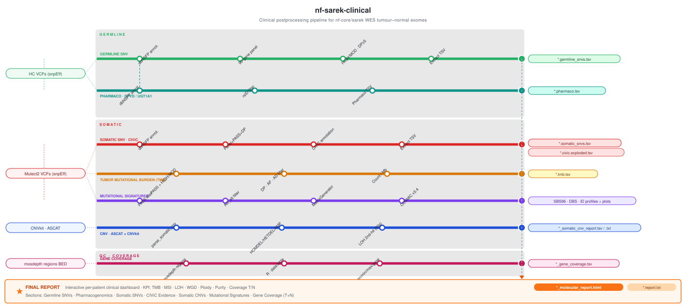

# nf-sarek-clinical

**Clinical interpretation postprocessing pipeline for nf-core/sarek WES cancer exome outputs.**

[](https://www.nextflow.io/)
[](https://www.docker.com/)



---

## Overview

`nf-sarek-clinical` is a Nextflow DSL2 pipeline that takes the output of [nf-core/sarek](https://nf-co.re/sarek) (tumour–normal WES) and produces a clinical-grade molecular report (HTML + PDF).

| Module | Analysis | Output |
|--------|----------|--------|
| **Germline SNV** | dbNSFP annotation → 90-gene panel + ACMG P/LP/VUS classification (9-tool in silico panel + REVEL + ClinVar + gnomAD rescue) | `*.germline_snvs.tsv`, `*.germline_snvs_acmg_annotated.tsv` |
| **Pharmacogenomics** | DPYD / UGT1A1 / CYP2D6 / CYP2C19 / NUDT15 rsID filter | `*.pharmaco.tsv` |
| **Germline CNV (GATK)** | Cohort PoN gCNV calling + MANE annotation (NP ≥ 5, QA ≥ 10) | `*_segments_annotated.tsv` |
| **Somatic SNV** | dbNSFP + somatic panel + CIViC annotation + AMP/ASCO/CAP tier | `*.somatic_snvs.tsv`, `*.civic.exploded.tsv` |
| **Somatic CNV (ASCAT/CNVkit)** | HOMDEL / HETDEL / AMP / LOH (38-gene panel) + somatic biallelic detection | `*_somatic_cnv_report.tsv` |
| **Somatic CNV (GATK)** | Allele-specific copy-number with denoising PoN | `*_annotated.tsv` |
| **TMB** | PASS + impact + depth filter → mut/Mb | `*.tmb.tsv` |
| **Mutational Signatures** | SigProfilerMatrixGenerator + SigProfilerAssignment (COSMIC v3.4) SBS96/DBS/ID | assignment activities + 4 PNG plots |
| **HRD** | HRProfiler: SBS + indel + CNV48 → logistic model | `*_hrd_predictions.tsv` |
| **Gene Coverage** | Per-gene mean/min/max depth from mosdepth | `*_gene_coverage.tsv` |
| **Germline–Somatic Correlation** | Two-hit analysis (P/LP germline + somatic second hits) + somatic biallelic detection + SBS/ID signature correlation | `correlation_section.json` |
| **HTML + PDF Report** | Interactive HTML + printable PDF with Major Clinical Findings cards | `*_molecular_report.html`, `*_clinical_report.pdf` |

---

## Running the pipeline

### Option A — Full pipeline from FASTQ (recommended)

`run_full.sh` orchestrates nf-core/sarek (alignment + variant calling) followed by nf-sarek-clinical (clinical report).

#### Step 1 — Create the samplesheet

```csv
patient,sex,status,sample,lane,fastq_1,fastq_2
1229,XY,0,1229_N07,2,/home/user/reads/.../1229_N07_L2_1.fq.gz,/home/user/reads/.../1229_N07_L2_2.fq.gz
1229,XY,1,1229_T08,1,/home/user/reads/.../1229_T08_L1_1.fq.gz,/home/user/reads/.../1229_T08_L1_2.fq.gz
1229,XY,1,1229_T08,2,/home/user/reads/.../1229_T08_L2_1.fq.gz,/home/user/reads/.../1229_T08_L2_2.fq.gz
```

> Sample naming convention: `<patient>_N##` for normal, `<patient>_T##` for tumor.

#### Step 2 — Launch

```bash
cd /home/user/nf-sarek-clinical

./run_full.sh \
  --run        <RUN_NAME> \
  --samplesheet /home/user/runs/<RUN_NAME>/samplesheet.csv
```

#### Common flags

```bash
# Resume after interruption
./run_full.sh --run <RUN_NAME> --samplesheet /path/to/samplesheet.csv --resume

# Clinical report only (sarek already completed)
./run_full.sh --run <RUN_NAME> --skip-sarek

# Resume clinical report only
./run_full.sh --run <RUN_NAME> --skip-sarek --resume
```

#### Output layout

```
/home/user/runs/<RUN_NAME>/
├── samplesheet.csv          ← input
├── results/                 ← nf-core/sarek outputs (BAMs, VCFs, CNVs, QC)
├── clinical_work/           ← nf-sarek-clinical work dir
└── clinical_results/        ← HTML + PDF clinical reports  ← final output
```

---

### Option B — Clinical report only

Use when nf-core/sarek was run separately. Requires Nextflow ≥ 23.04.0 and Docker ≥ 20.10.

```bash
cd /home/user/nf-sarek-clinical

nextflow run main.nf \
  -profile docker \
  -work-dir /home/user/runs/MY_RUN/clinical_work \
  --sarek_outdir  /home/user/runs/MY_RUN/results \
  --run_name      MY_RUN \
  --outdir        /home/user/runs/MY_RUN/clinical_results \
  --dbnsfp        /home/user/dbNSFP/dbNSFP4.1a.txt.gz \
  --snpsift_jar   /home/user/snpEff/SnpSift.jar \
  --panel_bed     /home/user/supporting_files/hg38/agilent/S07604514_hs_hg38/S07604514_Regions.bed \
  --gcnv_ploidy_model   /home/user/supporting_files/cnv/ploidy-model \
  --gcnv_pon_dir        /home/user/supporting_files/cnv/PoN_CNV \
  --gcnv_interval_list  /home/user/supporting_files/cnv/exomas.interval_list \
  --gcnv_fasta          /home/user/supporting_files/hg38/hg38.fa \
  --gcnv_dict           /home/user/supporting_files/hg38/hg38.dict \
  --gcnv_mane_txt       /home/user/supporting_files/cnv/exons_mane.txt \
  --gcnv_exon_r         /home/user/supporting_files/cnv/exon_annotation.R \
  --somatic_pon_hdf5       /home/user/supporting_files/cnv/wes-do-gc.pon.hdf5 \
  --somatic_interval_list  /home/user/supporting_files/cnv/preprocessed.interval_list \
  --common_snps_vcf        /home/user/supporting_files/cnv/common_snps_preprocessed.vcf.gz \
  --somatic_fasta          /home/user/supporting_files/cnv/main_chroms/hg38.main_chroms.fa \
  --somatic_dict           /home/user/supporting_files/cnv/main_chroms/hg38.main_chroms.dict \
  --somatic_annotate_r     /home/user/supporting_files/cnv/annotate_cnvs_complete_fixed.R
```

#### Skip flags (when data is missing)

| Flag | When to use |
|------|------------|
| `--skip_somatic_cnv true` | No ASCAT/CNVkit output |
| `--skip_hrd true` | No ASCAT segments |
| `--skip_germline_cnv true` | No normal BAMs |
| `--skip_somatic_cnv_gatk true` | No tumor BAMs |
| `--skip_signatures true` | Too few somatic variants |
| `--skip_coverage true` | No mosdepth results |
| `--skip_pdf_report true` | HTML only |

---

## Requirements

| Tool | Version |
|------|---------|
| **Nextflow** | ≥ 23.04.0 |
| **Docker** | ≥ 20.10 |
| RAM | ≥ 32 GB (GATK gCNV peaks at ~56 GB) |
| Disk | ≥ 200 GB (reference databases + work dir) |

**Sarek prerequisite:** nf-core/sarek ≥ 3.3.0 with tools: `haplotypecaller,mutect2,cnvkit,ascat,msisensorpro,snpeff`

---

## Parameters

### Required

| Parameter | Description |
|-----------|-------------|
| `--sarek_outdir` | Completed nf-core/sarek results directory |
| `--run_name` | Run identifier (used in filenames and report header) |
| `--outdir` | Where clinical results will be written |
| `--dbnsfp` | Path to `dbNSFP4.x.txt.gz` (bgzipped + tabix indexed) |
| `--snpsift_jar` | Path to `SnpSift.jar` |

### SNV & TMB

| Parameter | Default | Description |
|-----------|---------|-------------|
| `--germline_panel` | `assets/gene_panels/germline_90_cancer_predisposition.txt` | 90-gene hereditary cancer panel |
| `--somatic_snv_panel` | `assets/gene_panels/somatic_snv_panel.txt` | Somatic SNV gene list |
| `--germline_min_dp` | `5` | Min depth for germline variants |
| `--panel_bed` | — | WES capture BED for TMB Mb calculation |
| `--tmb_min_dp` | `10` | Min tumor depth for TMB |
| `--tmb_min_af` | `0.05` | Min allele fraction for TMB |

### HRD

| Parameter | Default | Description |
|-----------|---------|-------------|
| `--hrd_organ` | `BREAST` | Organ model: `BREAST` or `OVARIAN` |
| `--hrd_threshold` | `0.45` | HRD probability threshold |

### Module toggles

| Parameter | Default | Description |
|-----------|---------|-------------|
| `--skip_germline_cnv` | `false` | Skip GATK germline gCNV |
| `--skip_somatic_cnv` | `false` | Skip ASCAT + CNVkit interpretation |
| `--skip_somatic_cnv_gatk` | `false` | Skip GATK somatic CNV |
| `--skip_signatures` | `false` | Skip mutational signatures |
| `--skip_hrd` | `false` | Skip HRD |
| `--skip_pharmaco` | `false` | Skip pharmacogenomics |
| `--skip_coverage` | `false` | Skip gene coverage |
| `--skip_pdf_report` | `false` | Skip clinical PDF |

---

## Output

```
clinical_results/
├── germline/
│   ├── snv/extract/
│   │   ├── *.germline_snvs.tsv                   — variants passing all filters (P/LP/VUS in report)
│   │   ├── *.germline_all_filtered.tsv            — all rejected variants with FILTER_REASON column
│   │   └── *.germline_snvs_acmg_annotated.tsv     — all candidates with ACMG_class, criteria, insil scores
│   ├── pharmaco/            *.pharmaco.tsv
│   └── cnv_gatk/annotated/  *_segments_annotated.tsv
├── somatic/
│   ├── snv/extract/         *.somatic_snvs.tsv
│   ├── snv/civic_extract/   *.civic.exploded.tsv
│   ├── cnv/                 *_somatic_cnv_report.tsv
│   ├── cnv_gatk/annotated/  *_annotated.tsv
│   ├── tmb/                 *.tmb.tsv
│   ├── signatures/
│   │   ├── matrix_profiles/output/   SBS/, ID/, DBS/ observed matrices
│   │   └── assignment/               COSMIC v3.4 activities + 4 PNG plots
│   └── hrd/                 *_hrd_predictions.tsv
├── qc/gene_coverage/        *_gene_coverage.tsv
└── reporting/
    ├── *_molecular_report.html
    ├── *_molecular_report.txt
    └── *_clinical_report.pdf
```

### Report section order (PDF)

| # | Section | Key filter |
|---|---------|-----------|
| 0 | **Major Clinical Findings** | HRD/MMR/CNV triggers |
| 1 | **Germline–Somatic Correlation** | P/LP only; second hit or biomarker match |
| 2 | **Germline SNVs** | ACMG P/LP/VUS |
| 3 | **Somatic SNVs** | All from filtered TSV |
| 4 | **Somatic CNVs (ASCAT/CNVkit)** | 38-gene panel |
| 5 | **TMB · Pharmacogenomics · Gene Coverage · HRD** | — |
| 6 | **Mutational Signatures** | SBS96 + ID83 spectra + etiology plots |
| 7 | **Germline/Somatic CNVs (GATK)** | All annotated segments |

---

## Gene Panels

Built-in panels in `assets/gene_panels/`:

- **`germline_90_cancer_predisposition.txt`** — 90 hereditary cancer genes (ACMG SF v3.2)
- **`somatic_38_oncogenes.txt`** — 38 actionable somatic genes for CNV reporting
- **`somatic_snv_panel.txt`** — Somatic SNV panel (oncogenes, TSGs, DNA repair)

Custom panel: `--germline_panel /path/to/my_panel.txt` (one gene symbol per line).

---

## Troubleshooting

| Problem | Solution |
|---------|---------|
| Session lock error | `rm -f /home/user/nf-sarek-clinical/.nextflow/cache/*/db/LOCK` |
| Task fails after code fix | Delete the stale work dir: `rm -rf clinical_work/XX/XXXX…` then `-resume` |
| Out of memory | Lower `process_high` memory in `conf/base.config` |
| gCNV model version mismatch | Rebuild PoN with same GATK version (`broadinstitute/gatk:4.6.2.0`) |
| CIViC annotation fails | Requires internet on first run; step passes through unannotated on failure |
| ACMG scores differ between HTML and PDF | Check all three ACMG implementations are in sync: `bin/final_report_acmg.py`, `bin/clinical_pdf_report.py`, `modules/local/snpsift_germline/main.nf` Step 4 |

---

## Citation

If you use `nf-sarek-clinical` in your research, please cite:

- **nf-core/sarek**: Garcia M, et al. (2020). *Genome Medicine*.
- **dbNSFP**: Liu X, et al. (2020). *Genome Medicine*.
- **CIViC/civicpy**: Griffith M, et al. (2017). *Nature Genetics*.
- **SigProfilerAssignment**: Bergstrom EN, et al. (2022). *Cell Genomics*.
- **HRProfiler**: Chopra N, et al. (2024). [github.com/FlorPio/HRProfiler-workflow](https://github.com/FlorPio/HRProfiler-workflow).
- **ASCAT**: Van Loo P, et al. (2010). *PNAS*.

## License

MIT — see [LICENSE](LICENSE).
